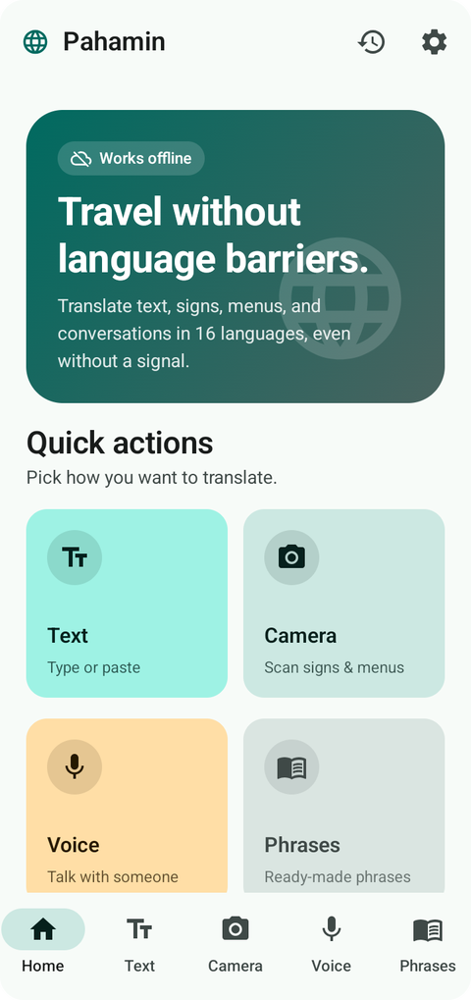
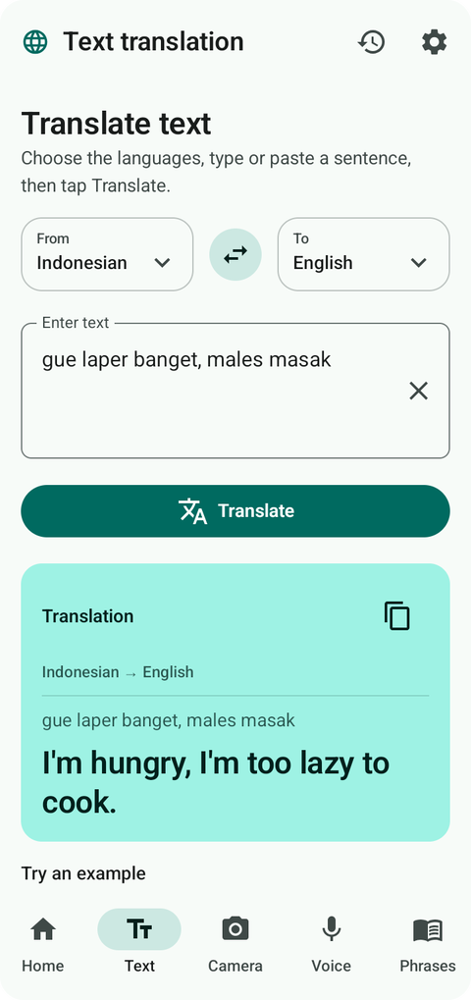
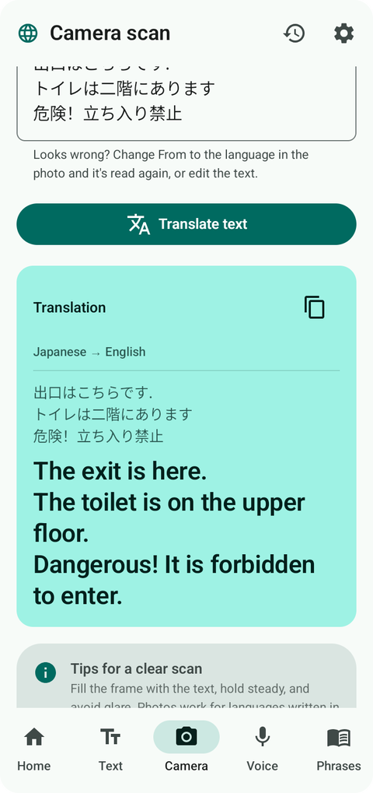
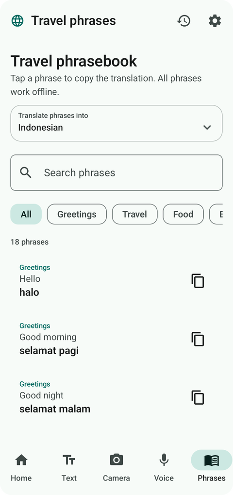
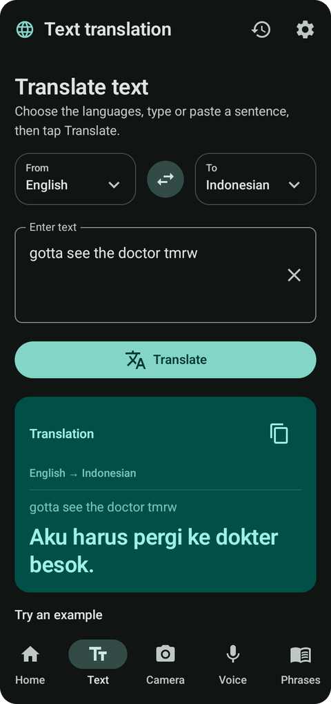

<div align="center">


# Pahamin

**The offline translator that understands how people actually type.**

Text, photos, and voice in 16 languages, right on your Android phone.<br>
No signal, no account, no ads.

[](https://github.com/ObhinAtilarizHuda/Pahamin/releases/latest)
[](https://github.com/ObhinAtilarizHuda/Pahamin/releases)
[](#install)
[](#languages)
[](#privacy)

[](https://github.com/ObhinAtilarizHuda/Pahamin/releases/latest)

[Features](#features) · [Languages](#languages) · [Install](#install) · [Privacy](#privacy) · [FAQ](#faq) · [Support](#support) · [Bahasa Indonesia](#bahasa-indonesia)

<br>

<table>
  <tr>
    <td align="center"><br><sub>Choose how to translate</sub></td>
    <td align="center"><br><sub>Type the way you text</sub></td>
    <td align="center"><br><sub>Scan signs from a photo</sub></td>
    <td align="center"><br><sub>Ready-made travel phrases</sub></td>
    <td align="center"><br><sub>Dark mode and color palettes</sub></td>
  </tr>
</table>

</div>

## Why Pahamin

| | |
|---|---|
| **Works without a signal** | On a plane, in the countryside, or abroad without a SIM. Everything is already on your phone. |
| **Gets everyday language** | Knows common chat spelling and slang in all 16 languages, so you don't have to write like a textbook. |
| **Stays on your phone** | The app has no internet permission, so your text, photos, and voice can't be sent anywhere. |

## See it in action

Real results from the app:

| You type | From → To | Pahamin says |
|---|---|---|
| `males masuk kerja` | Indonesian → English | I'm too lazy to go to work. |
| `gue laper banget, males masak` | Indonesian → English | I'm hungry, I'm too lazy to cook. |
| `bokap lo kerja di mana?` | Indonesian → English | Where does your dad work? |
| `gotta see the doctor tmrw` | English → Indonesian | Aku harus pergi ke dokter besok. |
| `idk what u mean` | English → Indonesian | Aku tidak tahu apa maksudmu. |
| `kp was du meinst` | German → English | I don't know what you mean. |
| `tqm amiga` | Spanish → English | I love you very much. |
| `to com fome` | Portuguese → English | I'm hungry. |

## Features

- **Translate text.** Type or paste up to 5,000 characters, and stop any time.
- **Scan a photo.** Take or choose a photo of a sign or label, then correct the recognized text if you need to.
- **Talk.** Say a sentence, see what was heard next to its translation, and hear it read aloud.
- **Travel phrases.** Greetings, directions, food, and emergency phrases, ready instantly and easy to copy.
- **History.** Recent translations stay on your phone until you clear them.
- **Make it yours.** Choose a color palette, dark mode, or reduced motion.

## Languages

Translate between any two of them, in either direction.

| | | | |
|---|---|---|---|
| English | Bahasa Indonesia | 日本語 (Japanese) | 한국어 (Korean) |
| 中文 (Chinese) | العربية (Arabic) | ไทย (Thai) | Tiếng Việt (Vietnamese) |
| Bahasa Melayu (Malay) | Español (Spanish) | Français (French) | Deutsch (German) |
| Italiano (Italian) | Português (Portuguese) | Nederlands (Dutch) | Türkçe (Turkish) |

## Install

| Requirement | |
|---|---|
| Android | 10 or newer, 64-bit phone (arm64) |
| Memory | 4 GB of RAM recommended |
| Storage | About 820 MB download, around 1 GB free once installed |

1. Download `Pahamin-1.0.0.apk` from the [latest release](https://github.com/ObhinAtilarizHuda/Pahamin/releases/latest), preferably on Wi-Fi.
2. Open the file. If Android asks, allow installs from your browser or file manager.
3. Open Pahamin. There is no sign-up and nothing else to download.

Android may warn that the app comes from outside Google Play, which is normal for an app installed this way. Only download it from this page.

## Privacy

Pahamin has no account, no ads, and no tracking. Your text, photos, and voice are processed on your phone. Photos taken in the app and voice recordings are deleted after use, and your history is not backed up to the cloud.

You can check the "no internet" claim yourself with Android's own tools:

```
aapt2 dump permissions Pahamin-1.0.0.apk
```

You'll see the microphone (for voice translation, and only asked for when you use it), one internal permission that Android's libraries add for themselves, and no `android.permission.INTERNET`. The optional tip button opens your own browser.

## Good to know

Better to read this now than to find out on a trip.

- **It can make mistakes.** Like all machine translation, it can get names, numbers, and brand-new slang wrong. **For allergies, medicine, emergencies, or legal matters, also show the original text or confirm with a person.**
- **Menus are the hardest.** Local dishes and shop names often come out wrong, so treat a scanned menu as a rough guide.
- **Vietnamese photos aren't reliable yet.** Photo scanning loses many Vietnamese accent marks, so the app asks you to check the text first. Typing Vietnamese works much better.
- **Speed depends on the languages.** On a budget phone (tested on a POCO C71 with 4 GB of RAM), Indonesian and English take under a second per sentence. Other pairs take about 2 to 6 seconds, and long text can take a few minutes.
- **Reading aloud uses your phone's voices.** Some voices may need a one-time download from your phone's text-to-speech settings.

## FAQ

<details>
<summary><b>Is it really free?</b></summary>

Yes. There are no ads and nothing is locked. You can [leave a tip](#support) if you like, but it doesn't unlock anything.
</details>

<details>
<summary><b>Why is the download so big?</b></summary>

The translation, photo, and voice engines all live inside the app, which is what lets it work with no internet at all.
</details>

<details>
<summary><b>Is it on Google Play or iPhone?</b></summary>

Not yet. For now it's Android only, and you install the APK from this page.
</details>

<details>
<summary><b>Is the source code available?</b></summary>

The app's own source code isn't public. It's built on the open-source projects listed under [Credits](#credits).
</details>

<details>
<summary><b>A translation came out wrong. What can I do?</b></summary>

[Open an issue](https://github.com/ObhinAtilarizHuda/Pahamin/issues) with what you typed, the two languages, and what you expected. That's what makes the app better.
</details>

## Support

Pahamin is made by an independent developer. If it helped you, you can **[leave a tip on Sociabuzz](https://sociabuzz.com/devbon/support)**. Tips are optional and don't unlock anything.

## Credits

Pahamin stands on the work of these projects. Full license texts are in the app under **Settings → About → Open-source licenses**.

| Project | Used for | License |
|---|---|---|
| [OPUS-MT](https://github.com/Helsinki-NLP/Opus-MT) | Indonesian and English translation | Apache 2.0, CC BY 4.0 |
| [M2M100](https://github.com/facebookresearch/fairseq/tree/main/examples/m2m_100) | Translation between the other languages | MIT |
| [Whisper](https://github.com/openai/whisper) and [whisper.cpp](https://github.com/ggml-org/whisper.cpp) | Speech recognition | MIT |
| [RapidOCR](https://github.com/RapidAI/RapidOCR) and [PaddleOCR](https://github.com/PaddlePaddle/PaddleOCR) | Reading text in photos | Apache 2.0 |
| [ONNX Runtime](https://github.com/microsoft/onnxruntime) and [OpenCV](https://github.com/opencv/opencv) | Running the models and processing images | MIT, Apache 2.0 |
| [Tatoeba](https://tatoeba.org) and [Asian Language Treebank](https://www2.nict.go.jp/astrec-att/member/mutiyama/ALT/) | Sentences for further training (not included in the app) | CC BY 2.0 FR, CC BY 4.0 |

## License

Pahamin is free to download and use. © 2026 devbon. All rights reserved.

---

## Bahasa Indonesia

<details>
<summary><b>Baca dalam Bahasa Indonesia</b></summary>

<br>

**Penerjemah offline yang paham cara orang benar-benar mengetik.** Terjemahkan teks, foto, dan suara dalam 16 bahasa, langsung di HP Android-mu. Tanpa sinyal, tanpa akun, tanpa iklan.

**[Unduh APK terbaru](https://github.com/ObhinAtilarizHuda/Pahamin/releases/latest)** · Android 10+ · 64-bit (arm64) · sekitar 820 MB · disarankan RAM 4 GB

**Tetap jalan tanpa sinyal.** Di pesawat, di pelosok, atau di luar negeri tanpa SIM. Semua yang dibutuhkan sudah ada di HP-mu.

**Paham bahasa sehari-hari.** Pahamin mengenal ejaan chat dan bahasa gaul yang umum di 16 bahasa, jadi kamu bisa mengetik seperti saat chatting. `males masuk kerja` jadi "I'm too lazy to go to work."

**Tetap di HP-mu.** Aplikasi ini tidak punya izin internet, jadi teks, foto, dan suaramu tidak bisa terkirim ke mana pun.

**Yang perlu kamu tahu:**

- Terjemahan mesin bisa salah, terutama nama, angka, dan bahasa gaul yang masih baru. Untuk alergi, obat, keadaan darurat, atau urusan hukum, tunjukkan juga teks aslinya atau pastikan ke orang langsung.
- Menu paling sulit: nama makanan lokal dan nama toko sering meleset, jadi anggap hasil scan menu sebagai gambaran kasar.
- Scan foto bahasa Vietnam belum bisa diandalkan, jadi lebih baik ketik teksnya.
- Di HP kelas ekonomi, Indonesia dan Inggris butuh kurang dari sedetik per kalimat, sedangkan pasangan bahasa lain sekitar 2 sampai 6 detik.
- Suara baca memakai suara bawaan HP, dan sebagian mungkin perlu diunduh dulu dari pengaturan text-to-speech.

**Cara pasang:** unduh `Pahamin-1.0.0.apk`, buka filenya, dan izinkan pemasangan kalau Android meminta. Android mungkin memberi peringatan karena aplikasi ini dipasang dari luar Google Play. Itu wajar, tapi pastikan kamu mengunduhnya hanya dari halaman ini.

Suka dengan Pahamin? Kamu bisa **[kasih tip lewat Sociabuzz](https://sociabuzz.com/devbon/support)**. Tip ini sukarela dan tidak membuka fitur apa pun.

</details>
